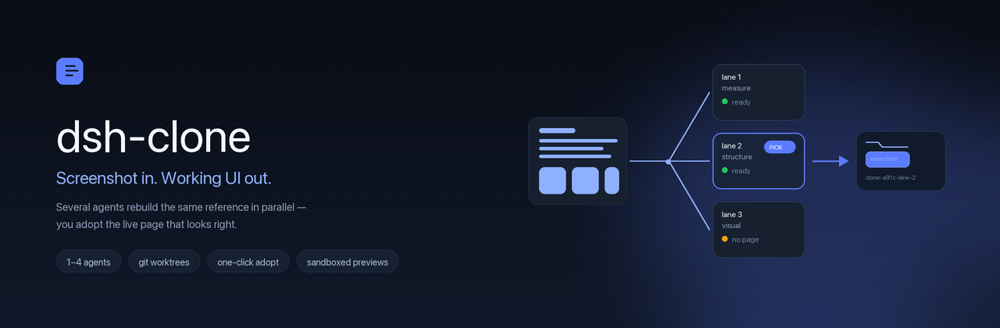
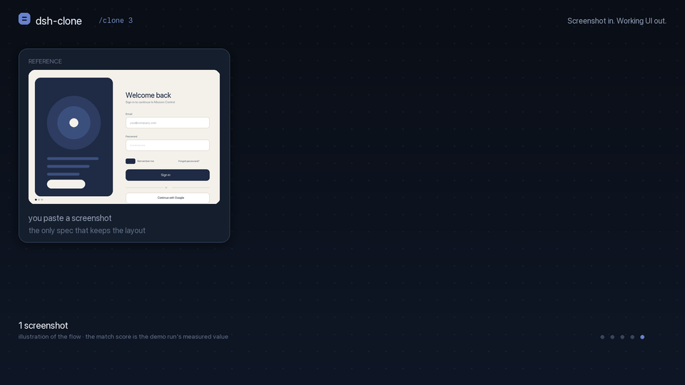
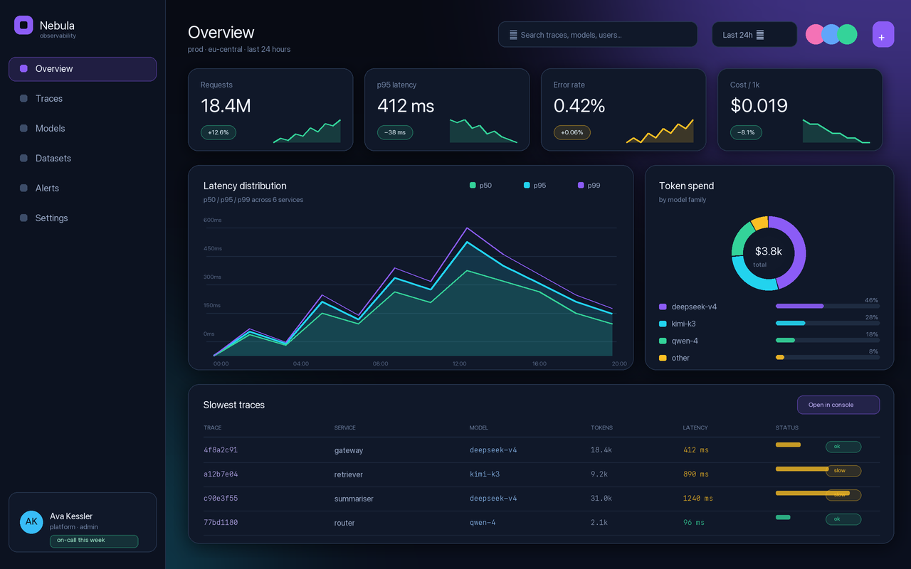
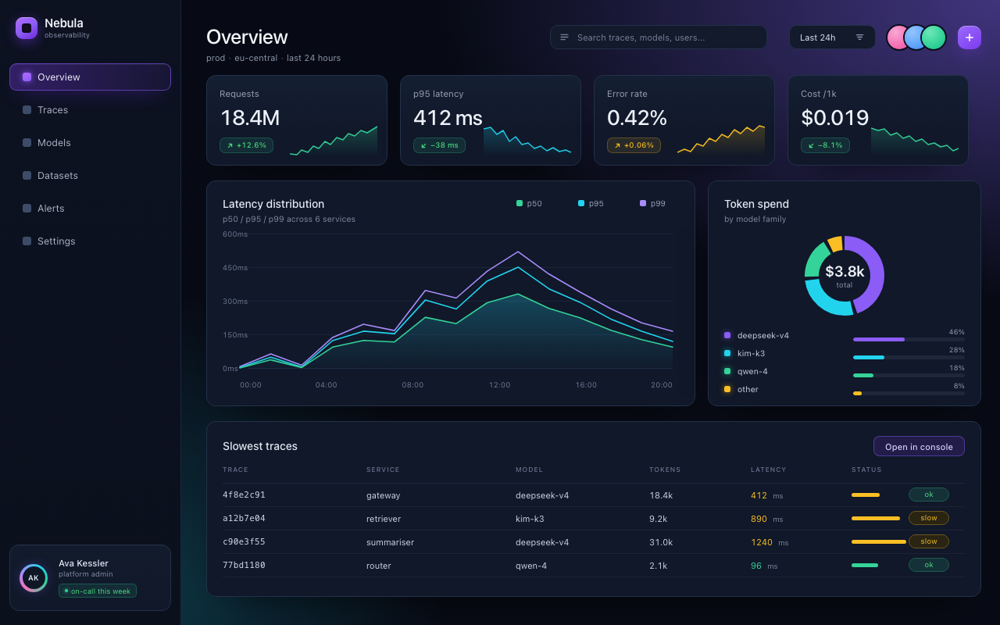
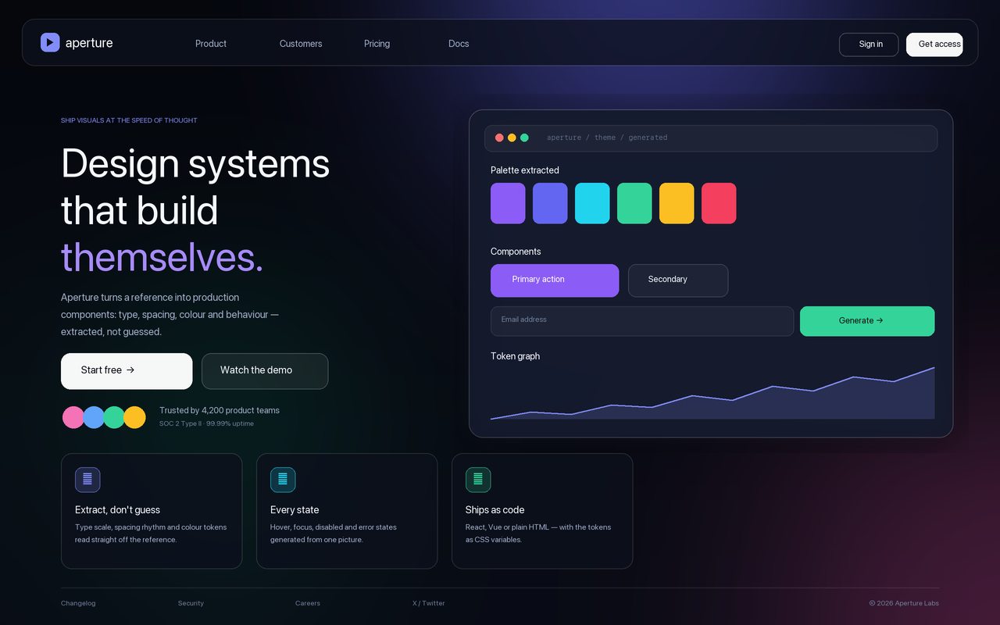
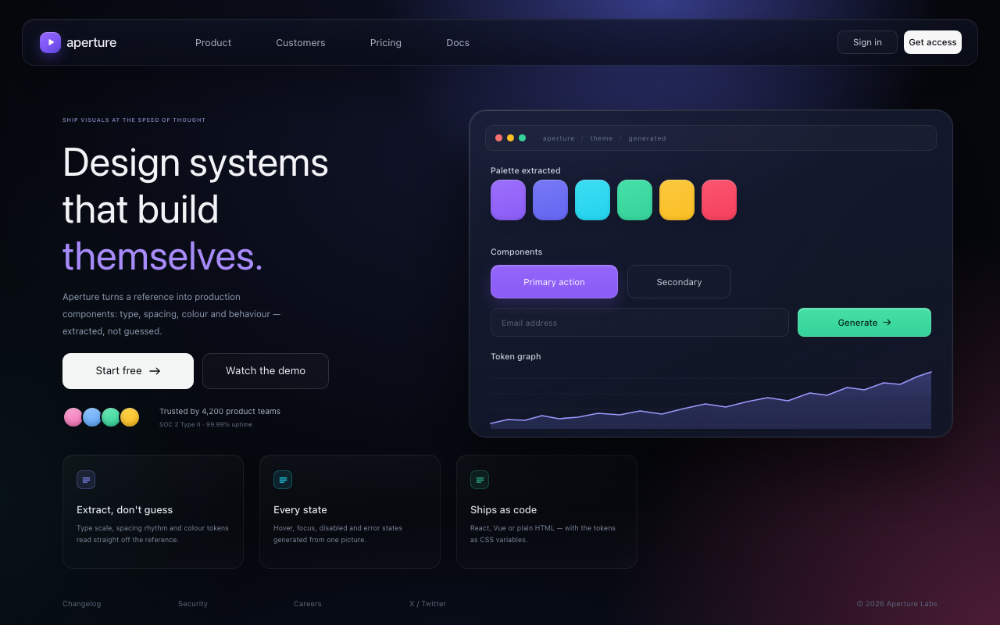
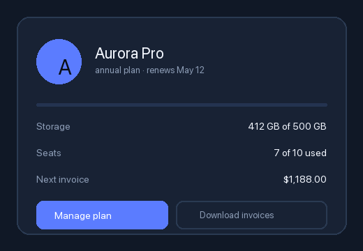
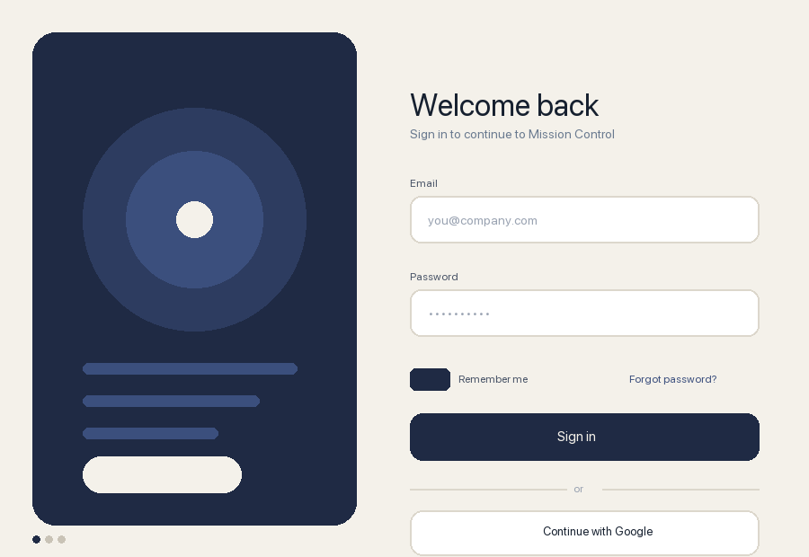

<p align="center">
  <a href="https://egorfedorov.github.io/dsh-clone/"></a>
</p>

<p align="center">
  <a href="LICENSE"></a>
  
  
  <a href="https://egorfedorov.github.io/dsh-clone/demo/"></a>
  <a href="https://github.com/egorfedorov/dsh-clone/stargazers"></a>
</p>

<h1 align="center">Screenshot in. Working UI out.</h1>

<p align="center">
  Paste a screenshot of any interface. Run <code>/clone 3</code>. Three agents rebuild it in parallel,<br>
  each in its own isolated directory. A live panel shows the reference beside every attempt,<br>
  rendered and scored. You adopt the page that looks right — and it is already a working page.
</p>

<p align="center">
  <a href="https://egorfedorov.github.io/dsh-clone/demo/"><b>→ Open a real clone in the browser</b></a>
  <br>
  <sub>built by this plugin from <a href="docs/assets/reference.png">this screenshot</a> · 92.7% picture match</sub>
</p>

<p align="center">
  
</p>

---

## The 30-second version

```
you:  [paste a screenshot]  /clone 3
me:   ▸ three agents, three isolated directories, same reference
      ▸ live panel: reference | lane 1 | lane 2 | lane 3   (rendered + scored)
you:  [Adopt this one]
me:   ▸ ./clone-a91c-lane-2/index.html  ← open it, it runs
```

No build step, no dependencies, no server. The adopted page is plain HTML, CSS and vanilla JS.

## Why this exists

A screenshot is the most precise specification a person can give. Every other input loses information: a paragraph drops the spacing rhythm, the type scale, the alignment of every block; a component list drops the picture.

The usual flow is still: describe it, get one attempt, describe the differences, get another attempt. One attempt is a lottery — you cannot tell whether the model misunderstood you or simply chose a different solution, because you only ever see one.

`dsh-clone` changes the cost of being wrong. Three or four builders see the same reference and work the same problem from different angles, every delivered page is rendered and compared with the reference, and you keep the best.

| Lane strategy | What that builder is told to do |
|---|---|
| **Measure first** | write a layout spec — regions, grid, spacing scale, sampled hex palette, type scale — then build strictly to it |
| **Structure first** | the whole page as semantic HTML first, then style region by region from the outside in |
| **Visual first** | reproduce the picture first — surfaces, type, spacing, silhouette — then add only the behaviour the image implies |
| **Component first** | find the 5-8 reused parts, define each once, compose the page from them |

## Demo

Real runs, not mocks: one command each, no retries, no hand edits. Every page is a static file — open it and it runs.

| Reference | The clone, rendered by the plugin | Result |
|---|---|---|
|  |  | **91.9% match** · 1280×800 · two lanes raced, the better one adopted · [open it](https://egorfedorov.github.io/dsh-clone/demo/nebula/) |
|  |  | **91.9% match** · 1280×800 · one lane · [open it](https://egorfedorov.github.io/dsh-clone/demo/aperture/) |
|  |  | **97.8% match** · 520×360 · one file · [open it](https://egorfedorov.github.io/dsh-clone/demo/card.html) |
|  |  | **79% match** · 900×620 · [open it](https://egorfedorov.github.io/dsh-clone/demo/) |

The dashboard and the landing page are the interesting ones: a sidebar, KPI cards with sparklines, a layered area chart, a donut, a data table; glass panels over a gradient mesh, a feature grid and a footer. Both were rebuilt from a single screenshot.

The score is the plugin's own, and it has three parts: both images are averaged into a coarse colour grid, the colour comparison forgives a small uniform shift, and a separate **structure** term compares where the detail sits. The mix measures *how much of the picture agrees*, not whether the page is correct — two unrelated dark interfaces land around 58%, a faithful rebuild above 90%. See [Honest limits](#honest-limits).

## Install

**In the Harness Web UI** — Settings → Plugins → **Add plugin**, then install by package name:

```
dsh-clone
```

Or add this repository's market index under **Plugins → Custom plugin indexes**, and install `dsh-clone` from the Discover tab in one click:

```
https://raw.githubusercontent.com/egorfedorov/dsh-clone/main/index.json
```

**From a checkout** (development):

```bash
git clone https://github.com/egorfedorov/dsh-clone
# Settings → Plugins → Add plugin → /absolute/path/to/dsh-clone
```

**Updating** — the market reports `update-available` when this repository's index (or npm) lists a newer compatible version. The market format has no in-place upgrade, so an update is a reinstall: your work lives in the workspace (`.dsh-clone/`, `clone-*/`), so reinstalling loses nothing. See [docs/PUBLISHING.md](docs/PUBLISHING.md) for the whole distribution story.

Requires a DeepSeek Harness profile with `subagents` (the `dsh-base` bundle ships the `spawn` backend) and Node 20+. Scoring additionally uses a Chromium-family browser if one is installed; without it everything else still works.

## Usage

Paste a screenshot into the conversation, then:

| Command | What it does |
|---|---|
| `/clone` | 3 lanes rebuild the last image in this conversation |
| `/clone 4` | four lanes — maximal spread of approaches |
| `/clone 2 darker, mobile-first` | two lanes plus a note every builder must honour |
| `/clone 3 ./mock.png` | use an explicit image path instead of the conversation image |
| `/clone status` | lane states, scores, and the suggested winner |
| `/clone pick 2` | adopt lane 2 into the workspace |
| `/clone refine 2 move the CTA up` | rebuild the adopted page with one change, scored against the same reference |
| `/clone cancel` | stop the builders |
| `/clone discard` | delete the scratch directories and lane branches |

The agent has the same operations as a tool, so you can also just say *"rebuild this screenshot, three tries"*:

```
clone({ action: "start", lanes: 3, note: "keep the sidebar" })
clone({ action: "status" })
clone({ action: "pick", lane: 2 })
```

### The panel

A **Clone** tab appears in the conversation view ring while a clone exists:

- the reference screenshot on the left, at the size the lanes are building for;
- one card per lane: a live iframe of the actual page, its strategy, elapsed time, tool calls, file count, token spend, and its **picture-match score** once rendered;
- the best-scoring lane is marked as suggested, and **Adopt this one** works on any lane that produced an `index.html`.

A small chip under the composer shows `clone · 2/3` while builders run, so you can leave the tab.

## How it works

**Isolation.** Each lane gets its own directory. Inside a git repository that is a real `git worktree` on its own branch (`dsh-clone/<id>-lane-<n>`), so nothing leaks between attempts and nothing touches your working tree. Outside a repository it is a plain directory under `.dsh-clone/<id>/lane-<n>/`. Existing `node_modules`, `.venv` and `vendor` are symlinked into each lane instead of reinstalled.

**The builders.** Each lane is a subagent with one job: read the reference image, then ship `index.html` plus any local CSS/JS/assets. The delivery contract is identical for every lane and non-negotiable:

> no build step · no network at runtime · no CDN · no placeholder copy · fill the viewport · approximate every image with CSS/SVG · leave no scratch files

The strategies differ; the contract does not. Every lane also carries an explicit effort budget (≈20-25 tool calls) and a wall-clock limit: a builder that keeps polishing is stopped, and whatever it already wrote is delivered and scored instead of stalling the clone.

**The score.** When a lane delivers, the plugin finds an installed Chromium-family browser (Chrome, Chromium, Edge, Brave — `DSH_CLONE_BROWSER` overrides), screenshots the page at the reference's own pixel size, and compares it with the reference: both images are averaged into a 48×32 colour grid and the mean absolute difference becomes a percentage. Highest score suggests the winner; you still choose. No browser, no score — the panel then falls back to completeness and finish order.

**The preview.** Lane pages are served from this page's own origin through `/api/dsh-clone/preview/<clone>/<lane>/` — no extra port, no proxy, the same authenticated connection the UI already uses. Because the HTML is model-written, it is served with a `sandbox` CSP (no `allow-same-origin`) and mounted in a `sandbox="allow-scripts"` iframe: a clone can run its own code, but it cannot reach your session, credentials, or the Harness API.

**Adoption.** `pick` copies the chosen lane into the workspace as `clone-<id>-lane-<n>/`, without `.git`, without the symlinked dependency directories, and without the builder's scratch files. The other lanes stay where they are until you `/clone discard`.

**Iteration.** `refine` takes an adopted lane, copies its page into a fresh single-lane clone and asks the builder for the smallest edit that satisfies one change — the reference and the viewport stay the same, so the new score is directly comparable and the clone reports the delta.

**Durability.** Each clone writes a small `state.json` next to its work. A plugin reload or a restart does not throw the run away: `status` and `pick` rebuild it from disk, and a lane that was mid-build keeps whatever it had already written, labelled as interrupted rather than pretending it finished.

**Budgets.** Every builder gets an effort budget in the prompt and a wall-clock limit (`laneTimeoutMs`); whichever is hit first settles the lane with whatever it delivered. `laneTokenBudget` adds a hard token ceiling and is off by default, because an agent re-sends its context on every step — a small ceiling stops honest builds mid-analysis, so it is a deliberate opt-in backstop rather than a default.

**The nudge.** Some models answer "measure first" by sampling the screenshot's pixels for their entire budget and then ending with nothing written. If a lane is past `nudgeAtTools` (12) tool calls with no `index.html` on disk, the plugin sends it one steering message: stop measuring, write the page now. One message, once per lane.

## Configuration

All optional; the defaults are the intended experience.

| Key | Default | Meaning |
|---|---|---|
| `lanes` | `3` | lane count when the command does not name one |
| `maxLanes` | `4` | hard cap on lanes per clone |
| `viewport` | `auto` | build and render size; `auto` uses the reference image's own pixel size |
| `laneTimeoutMs` | `900000` | wall-clock limit per lane (15 min); the lane is stopped and its output kept |
| `laneTokenBudget` | `0` (off) | token ceiling per lane. Off by default because an agent re-sends its context every step; 2M+ is a sensible backstop |
| `nudgeAtTools` | `12` | tool calls after which a lane with no `index.html` is told to stop analysing and write the page; `0` disables it |
| `provider` | `spawn` | `ctx.subagents` backend used for builders |
| `pollMs` | `900` | live counter refresh interval |
| `commandName` | `clone` | rename the slash command |
| `command` / `tool` | `true` | disable either entry point |

```yaml
- id: dsh-clone
  name: dsh-clone
  config:
    lanes: 4
    laneTimeoutMs: 600000
```

## Safety

- Clones are **static pages**: no package installs, no network at runtime, no server.
- Lane pages are sandboxed into an opaque origin, so model-written HTML cannot reach your session, credentials, or the Harness API.
- Every write happens inside the workspace: `.dsh-clone/` for scratch, `clone-*/` for adopted results, plus lane branches in your repository (removed by `/clone discard`).
- `git worktree` is used without touching your checkout: no commit, no checkout, no reset in your working tree. `test/git-lane.mjs` asserts exactly that.
- The scoring renderer is a one-shot headless screenshot of a local file. It loads no remote page.

## Honest limits

- **Cost is N×.** Three builders cost roughly three builds. `lanes: 2` is a reasonable everyday setting; `lanes: 1` makes it a plain "screenshot → page" button.
- **The score measures the picture, not the truth.** 92% agreement can still hide wrong copy, a missing form action, or broken behaviour. It ranks attempts; it does not certify one.
- **The score is coarse by design.** A 48×32 grid with shift tolerance is forgiving about a few pixels and strict about a panel on the wrong side; the structure term catches "right colour, wrong picture". Two lanes a few points apart are still a coin flip — open both before adopting.
- **Vision is required.** The builder must actually see the reference. A text-only model produces a guess; pair dsh-clone with a vision-capable route or a vision bridge plugin.
- **Images are approximated.** Without image generation, photos and illustrations become CSS/SVG stand-ins with the right silhouette and palette, not the original pixels.
- **Static output.** No Next.js project, no design system — by design, so the result is always runnable in one click.
- **Scoring needs an installed browser.** Chrome, Chromium, Edge or Brave on macOS, Windows or Linux; `DSH_CLONE_BROWSER` overrides the probe. No browser means no percentage, and nothing else changes.
- **A careful builder is a slow builder.** Hence the effort budget and the wall-clock limit; tune those, not your patience.

## Roadmap

1. **Region scoring** — "clone just this card": compare only the rectangle that matters instead of the whole page.
2. **Adopt as a diff** — when the workspace is a component library, adopt as an edit to an existing file instead of a new folder.
3. **Multi-reference** — several screenshots of the same flow, one page per screen.
4. **Panel screenshots in the storefront** — the four declared images are plugin output, not the panel itself.

## Repository layout

```
index.js            Host half: /clone command, clone tool, web routes, poller
client.js           Client half: the Clone panel and the composer chip
lib/engine.js       Clone state machine (pure, dependency-injected)
lib/prompts.js      The delivery contract, the effort budget, four strategies
lib/render.js       Headless screenshot through an installed Chromium browser
lib/score-lane.js   Render-and-score composition shared by the plugin and its test
lib/score.js        Coarse-grid picture comparison
lib/png.js          Dependency-free PNG decoder
lib/parse.js        /clone grammar
lib/rank.js         Adoptability, score-first ordering, suggestion
lib/preview.js      Static lane serving, media types, sandbox CSP, JSON routes
lib/util.js         Small pure helpers
test/smoke.mjs      30 tests, no Harness required
test/git-lane.mjs   worktree isolation against a real repository
test/render-score.mjs  real render + score through the plugin's own path
index.json          Format-1 plugin market index (Custom plugin indexes)
screenshots.json    Storefront screenshots (read by dsh-market)
tools/make-hero.py  Regenerates docs/assets/hero.png
tools/make-references.py  Regenerates the showcase reference screenshots
tools/make-icon.py  Regenerates the storefront icon
tools/make-demo.py  Regenerates docs/assets/demo.gif
docs/PUBLISHING.md  npm, the awesome list, indexes, the official program
docs/storefront/    Ready-to-submit entry for awesome-dsh-plugin
docs/index.html     GitHub Pages landing page
docs/demo/          Four real clones, served live
docs/ARCHITECTURE.md
ACCEPTABLE-USE.md
```

## Development

```bash
npm run check       # syntax-check every shipped file
npm test            # 30 assertions: grammar, ranking, scoring, engine lifecycle
npm run test:git    # the git-worktree isolation model against a real repository
npm run test:score  # a real render + score through the plugin's own code path
npm run test:all    # all three
```

The engine takes every side effect as a dependency, so the tests drive the real state machine against a temporary directory with fake subagents — no Harness, no network, no model. The pixel tests decode the demo reference and a committed real lane render, so a regression in either the decoder or the scoring curve fails the suite. `test/git-lane.mjs` builds a throwaway repository to prove that lanes are real worktrees, that your own dirty working tree and branch are untouched, that dependency directories are shared by symlink, and that discard removes worktrees and branches while the adopted copy survives. `test/render-score.mjs` goes through the plugin's own scoring path with two fake builders — one faithful, one deliberately desaturated — and asserts that both come back scored, that the faithful one wins, and that the snapshot carries the score and the render URL. It skips itself when no browser is installed.

## По-русски

Плагин для DeepSeek Harness: скидываешь скриншот интерфейса, пишешь `/clone 3` — три агента параллельно собирают его в изолированных папках (в репозитории — через git worktree). В панели «Clone» видно эталон и все попытки рядом; каждая готовая страница рендерится в headless-браузере и получает процент совпадения картинки. Нажимаешь «Adopt this one» — выбранный вариант копируется в рабочую папку как готовая страница. Остальные удаляются командой `/clone discard`.

Честно: стоимость — примерно N попыток; оценка совпадения меряет картинку, а не правильность (текст и поведение всё равно проверяй глазами); нужна модель, которая видит изображение.

## License

MIT — see [LICENSE](LICENSE). Use it on interfaces you have the right to rebuild; see [ACCEPTABLE-USE.md](ACCEPTABLE-USE.md).
